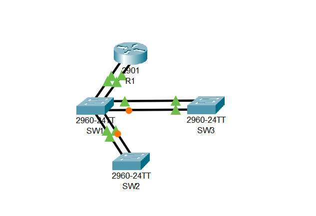
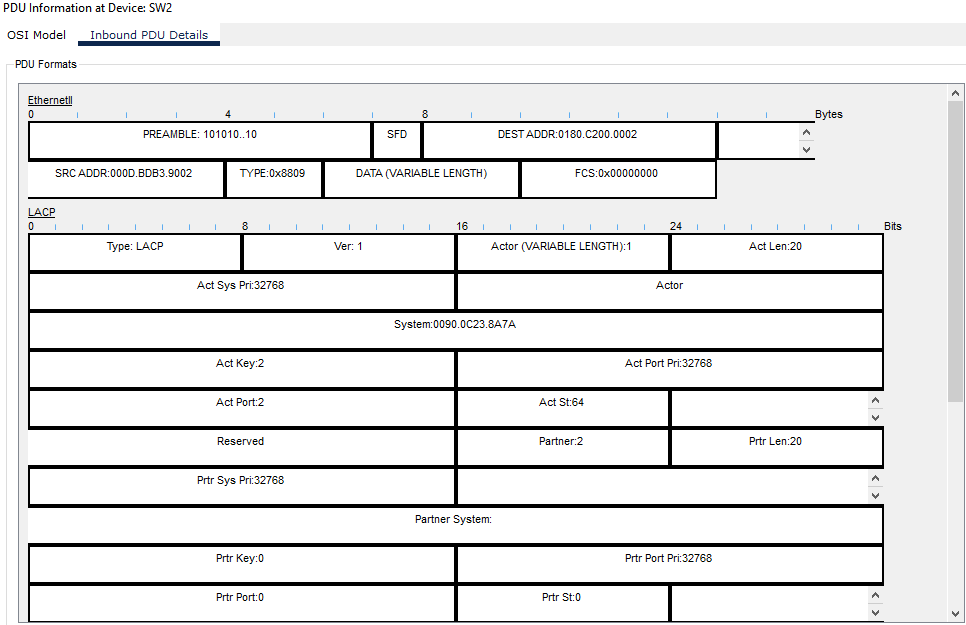

# Отчет по лабораторной работе №5
Выполнили: Капустин, Веселова, Поликарпова, гр. 439

## Топология


## Ответы на вопросы

1. Часть портов между коммутаторами заблокирована протоколом STP (оранжевые индикаторы) для предотвращения петель коммутации, а линки к маршрутизатору `R1` выключены по умолчанию (`administratively down`, красные индикаторы).

2. Канал `Po1` находится в состоянии `SU` (Layer 2, In Use), а порты — `P` (bundled in port-channel), так как статический режим `on` не проверяет ответную сторону. С точки зрения `SW1` канал готов передавать трафик (`Port-channel1 is up, line protocol is up`). Это может вызвать петлю коммутации или потерю пакетов («чёрную дыру»), пока на `R1` не настроена агрегация.

```text
SW1#show etherchannel summary
Flags:  D - down        P - in port-channel0
        I - stand-alone s - suspended
        H - Hot-standby (LACP only)
        R - Layer3      S - Layer2
        U - in use      f - failed to allocate aggregator
        u - unsuitable for bundling
        w - waiting to be aggregated
        d - default port

Number of channel-groups in use: 2
Number of aggregators:           2

Group  Port-channel  Protocol    Ports
------+-------------+-----------+----------------------------------------------

1      Po1(SU)           -      Gig0/1(P) Gig0/2(P) 
2      Po2(SD)           LACP   Fa0/1(I) Fa0/2(I) 

SW1#show etherchannel port-channel
                Channel-group listing:
                ----------------------

Group: 1
----------
                Port-channels in the group:
                ---------------------------

Port-channel: Po1
------------

Age of the Port-channel   = 00d:00h:14m:47s
Logical slot/port   = 2/1       Number of ports = 2
GC                  = 0x00000000      HotStandBy port = null
Port state          = Port-channel 
Protocol            =   PAGP
Port Security       = Disabled

Ports in the Port-channel:

Index   Load   Port     EC state        No of bits
------+------+------+------------------+-----------
  0     00     Gig0/1   On                 0
  0     00     Gig0/2   On                 0

SW1#show interfaces Po1
Port-channel1 is up, line protocol is up (connected)
  Hardware is EtherChannel, address is 0090.0c23.8a99 (bia 0090.0c23.8a99)
  MTU 1500 bytes, BW 2000000 Kbit, DLY 10 usec,
     reliability 255/255, txload 1/255, rxload 1/255
  Encapsulation ARPA, loopback not set
  Keepalive set (10 sec)
  Full-duplex, 1000Mb/s
  input flow-control is off, output flow-control is off
  Members in this channel: Gig0/1 ,Gig0/2 ,
  ARP type: ARPA, ARP Timeout 04:00:00
  Last input 00:00:02, output 00:00:01, output hang never
  Last clearing of "show interface" counters never
  Input queue: 0/75/0/0 (size/max/drops/flushes); Total output drops: 0
  Queueing strategy: fifo
  Output queue :0/40 (size/max)
  5 minute input rate 0 bits/sec, 0 packets/sec
  5 minute output rate 0 bits/sec, 0 packets/sec
     142 packets input, 18460 bytes, 0 no buffer
     Received 142 broadcasts, 0 runts, 0 giants, 0 throttles
     0 input errors, 0 CRC, 0 frame, 0 overrun, 0 ignored, 0 abort
     0 watchdog, 0 multicast, 0 pause input
     0 input packets with dribble condition detected
```

3. Агрегированный канал `Po2` находится в нерабочем состоянии `SD` (`Port-channel2 is down, line protocol is down`), а дочерние интерфейсы `Fa0/1` и `Fa0/2` — в состоянии `I` (stand-alone), так как `SW2` ещё не настроен и не отвечает по протоколу LACP. Канал не готов передавать трафик как единый интерфейс.

```text
SW1#show etherchannel summary
Flags:  D - down        P - in port-channel
        I - stand-alone s - suspended
        H - Hot-standby (LACP only)
        R - Layer3      S - Layer2
        U - in use      f - failed to allocate aggregator
        u - unsuitable for bundling
        w - waiting to be aggregated
        d - default port

Number of channel-groups in use: 2
Number of aggregators:           2

Group  Port-channel  Protocol    Ports
------+-------------+-----------+----------------------------------------------

1      Po1(SU)           -      Gig0/1(P) Gig0/2(P) 
2      Po2(SD)           LACP   Fa0/1(I) Fa0/2(I) 

SW1#show etherchannel port-channel
                Channel-group listing:
                ----------------------

Group: 2
----------
                Port-channels in the group:
                ---------------------------

Port-channel: Po2
------------

Age of the Port-channel   = 00d:00h:02m:16s
Logical slot/port   = 2/2       Number of ports = 2
GC                  = 0x00000000      HotStandBy port = null
Port state          = Port-channel 
Protocol            =   LACP
Port Security       = Disabled

Ports in the Port-channel:

Index   Load   Port     EC state        No of bits
------+------+------+------------------+-----------
  0     00     Fa0/1    Active             0
  0     00     Fa0/2    Active             0

SW1#show interfaces Po2
Port-channel2 is down, line protocol is down (disabled)
  Hardware is EtherChannel, address is 000a.f35e.3943 (bia 000a.f35e.3943)
  MTU 1500 bytes, BW 200000 Kbit, DLY 1000 usec,
     reliability 255/255, txload 1/255, rxload 1/255
  Encapsulation ARPA, loopback not set
  Keepalive set (10 sec)
  Half-duplex, 200Mb/s
  input flow-control is off, output flow-control is off
  Members in this channel: Fa0/1 ,Fa0/2 ,
  ARP type: ARPA, ARP Timeout 04:00:00
  Last input 00:00:08, output 00:00:05, output hang never
  Last clearing of "show interface" counters never
  Input queue: 0/75/0/0 (size/max/drops/flushes); Total output drops: 0
  Queueing strategy: fifo
  Output queue :0/40 (size/max)
  5 minute input rate 0 bits/sec, 0 packets/sec
  5 minute output rate 0 bits/sec, 0 packets/sec
     956 packets input, 193351 bytes, 0 no buffer
     Received 956 broadcasts, 0 runts, 0 giants, 0 throttles
     0 input errors, 0 CRC, 0 frame, 0 overrun, 0 ignored, 0 abort
     0 watchdog, 0 multicast, 0 pause input
     0 input packets with dribble condition detected
```

4. Информация о партнёре (`Partner System`, `Prtr Key`, `Prtr Port`, `Prtr St`) пустая или заполнена нулями, потому что на `SW2` протокол LACP ещё не настроен и он не отправлял ответных сообщений LACPDU.



5. Номера `channel-group` имеют локальное значение только внутри каждого коммутатора, поэтому их несовпадение (`2` на `SW1` и `1` на `SW2`) не мешает согласованию канала.

```text
SW2#show etherchannel port-channel
                Channel-group listing:
                ----------------------

Group: 1
----------
                Port-channels in the group:
                ---------------------------

Port-channel: Po1    (Primary Aggregator)
------------

Age of the Port-channel   = 00d:00h:00m:57s
Logical slot/port   = 2/1       Number of ports = 2
GC                  = 0x00000000      HotStandBy port = null
Port state          = Port-channel 
Protocol            =   LACP
Port Security       = Disabled

Ports in the Port-channel:

Index   Load   Port     EC state        No of bits
------+------+------+------------------+-----------
  0     00     Fa0/1    Passive            0
  0     00     Fa0/2    Passive            0
Time since last port bundled:    00d:00h:00m:57s    Fa0/2
```

6. Вывод состояния всех трёх агрегированных каналов на `SW1`:

```text
SW1#show etherchannel summary
Flags:  D - down        P - in port-channel
        I - stand-alone s - suspended
        H - Hot-standby (LACP only)
        R - Layer3      S - Layer2
        U - in use      f - failed to allocate aggregator
        u - unsuitable for bundling
        w - waiting to be aggregated
        d - default port


Number of channel-groups in use: 3
Number of aggregators:           3

Group  Port-channel  Protocol    Ports
------+-------------+-----------+----------------------------------------------

1      Po1(SU)           -      Gig0/1(P) Gig0/2(P) 
2      Po2(SU)           LACP   Fa0/1(P) Fa0/2(P) 
3      Po3(SU)           PAgP   Fa0/3(P) Fa0/4(P) 

SW1#show etherchannel port-channel
                Channel-group listing:
                ----------------------

Group: 1
----------
                Port-channels in the group:
                ---------------------------

Port-channel: Po1
------------

Age of the Port-channel   = 00d:00h:43m:08s
Logical slot/port   = 2/1       Number of ports = 2
GC                  = 0x00000000      HotStandBy port = null
Port state          = Port-channel 
Protocol            =   PAGP
Port Security       = Disabled

Ports in the Port-channel:

Index   Load   Port     EC state        No of bits
------+------+------+------------------+-----------
  0     00     Gig0/1   On                 0
  0     00     Gig0/2   On                 0
Time since last port bundled:    00d:00h:43m:08s    Gig0/2
Group: 2
----------
                Port-channels in the group:
                ---------------------------

Port-channel: Po2    (Primary Aggregator)
------------

Age of the Port-channel   = 00d:00h:29m:31s
Logical slot/port   = 2/2       Number of ports = 2
GC                  = 0x00000000      HotStandBy port = null
Port state          = Port-channel 
Protocol            =   LACP
Port Security       = Disabled

Ports in the Port-channel:

Index   Load   Port     EC state        No of bits
------+------+------+------------------+-----------
  0     00     Fa0/1    Active             0
  0     00     Fa0/2    Active             0
Time since last port bundled:    00d:00h:10m:08s    Fa0/2
Group: 3
----------
                Port-channels in the group:
                ---------------------------

Port-channel: Po3
------------

Age of the Port-channel   = 00d:00h:01m:24s
Logical slot/port   = 2/3       Number of ports = 2
GC                  = 0x00000000      HotStandBy port = null
Use code with caution.
Port state          = Port-channel
Protocol            =   PAGP
Port Security       = Disabled
Ports in the Port-channel:
Index   Load   Port     EC state        No of bits
------+------+------+------------------+-----------
0     00     Fa0/3    Desirable-Sl       0
0     00     Fa0/4    Desirable-Sl       0
Time since last port bundled:    00d:00h:01m:12s    Fa0/4
```
7. SW1#show running-config
Building configuration...

Current configuration : 1539 bytes
!
version 15.0
no service timestamps log datetime msec
no service timestamps debug datetime msec
no service password-encryption
!
hostname SW1
!
!
!
no ip domain-lookup
!
!
!
spanning-tree mode pvst
spanning-tree extend system-id
!
interface Port-channel1
!

**8.** Конфигурация интерфейсов после настройки `Port-channel2` и сравнение:

```text
interface Port-channel2
 switchport mode trunk
 switchport nonegotiate
 spanning-tree portfast trunk
!
interface FastEthernet0/1
 switchport mode trunk
 switchport nonegotiate
 channel-group 2 mode active
!
interface FastEthernet0/2
 switchport mode trunk
 switchport nonegotiate
 channel-group 2 mode active
```

8. **До настройки:** в конфигурации `Port-channel2` не было никаких параметров, а на физических портах `Fa0/1` и `Fa0/2` была прописана только привязка к группе (`channel-group 2 mode active`).
* **После настройки:** хотя команды вводились только внутри логического интерфейса `Port-channel2`, настройки `switchport mode trunk` и `switchport nonegotiate` автоматически скопировались на оба физических интерфейса (`Fa0/1` и `Fa0/2`), так как все порты в одном агрегированном канале должны иметь одинаковые параметры работы.
* **Исключение:** команда `spanning-tree portfast trunk` осталась только на логическом интерфейсе `Port-channel2` и не перенеслась на физические порты, так как протокол STP воспринимает всю связку как один логический порт.

**9.** По умолчанию используется алгоритм `src-mac`. Если большая часть трафика будет идти в направлении от `R1`, все пакеты будут приходить с одного и того же MAC-адреса источника (интерфейса `R1`), из-за чего весь поток пойдёт только по одному физическому линку из двух, а второй будет простаивать.

```text
SW1#show etherchannel load-balance
EtherChannel Load-Balancing Operational State (src-mac):
Non-IP: Source MAC address
  IPv4: Source MAC address
  IPv6: Source MAC address
```

**10.** Был выбран алгоритм `dst-mac`, так как он позволяет распределять трафик по разным физическим линкам в зависимости от MAC-адресов конечных получателей, к которым `R1` отправляет пакеты.

```text
SW1#show etherchannel load-balance
EtherChannel Load-Balancing Operational State (dst-mac):
Non-IP: Destination MAC address
  IPv4: Destination MAC address
  IPv6: Destination MAC address
```
